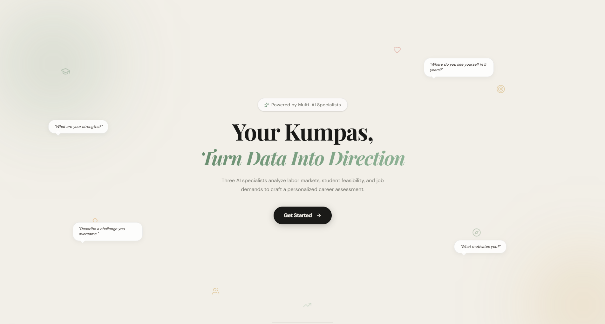

<div align="center">
  

  # Kumpas

  **An explainable multi-agent career alignment system for guidance counselors**

  [](https://nextjs.org/)
  [](https://react.dev/)
  [](https://supabase.com/)
  [](https://ai.google.dev/)
</div>

---

## Overview

Kumpas helps Philippine school guidance counselors turn student academic records and counseling notes into transparent, data-backed career recommendations.

The system supports Grade 10 and Senior High School counseling sessions. It combines Form 137, NCAE, NAT, and counselor-encoded session notes with a federated RAG knowledge base covering Philippine labor demand, academic feasibility, scholarship pathways, and program cost signals.

Kumpas is not a replacement for the counselor. It reduces repetitive document review and report preparation so counselors can spend more time guiding students through realistic career decisions.

---

## Application Preview

### Landing Page



*The counselor-facing entry point for starting a career assessment session.*

---

## How It Works

### 1. Intake and Extraction

Counselors upload student academic documents and enter structured session notes across five fields:

- Career Goal
- Personal Interests and Strengths
- Family and Financial Situation
- Concerns and Red Flags
- Counselor's Overall Impression

Kumpas uses private Supabase Storage for resumable uploads of academic documents and prepared note photographs, up to 10 MB (10,000,000 bytes) each. The server checks ownership, file size and decoded content before sending approved files to the paid Gemini API without local masking. Raw files are deleted after processing, with queued retries for failed deletions and scheduled cleanup for abandoned uploads. Counselors review and save editable extraction drafts before approval.

### 2. Academic Extraction and Confirmation

Kumpas extracts academic signals from Form 137, NCAE, and NAT records. Counselors review and confirm the extracted profile before any recommendation workflow continues.

### 3. Multi-Agent Analysis

Three specialist agents analyze the approved profile through separate knowledge silos:

| Specialist | Focus | Knowledge Grounding |
|---|---|---|
| Academic Auditor | Academic fit and aptitude signals | Student records and academic evidence |
| Industry Analyst | Labor demand and market viability | PSA OpenSTAT and DOLE BLE labor data |
| Feasibility Strategist | Pathway affordability and access | CHED, TESDA, scholarship, and program-cost data |

The synthesis layer ranks at least three distinct career paths and attaches reasoning, concerns, and source references.

### 4. Explainable Report Generation

Kumpas produces a counselor-facing results page and a downloadable PDF report with:

- Ranked career recommendations
- Academic evidence completeness
- Key signals and reasoning summaries
- Source attribution and ingestion timestamps
- Report download and session completion tracking

### 5. Session Orchestration

Session state, report lifecycle, progress indicators, and retention behavior are managed so the counselor can complete the workflow in a standard browser session.

---

## Technology Stack

| Layer | Technology |
|---|---|
| App Framework | Next.js 16, React 19 |
| Styling and UI | Tailwind CSS, shadcn-style components, lucide-react |
| Authentication | Supabase Auth |
| Database and Vector Store | Supabase Postgres with pgvector |
| AI Processing | Google Gemini API |
| Document Handling | Validated image/PDF extraction, editable evidence drafts and retryable artifact cleanup |
| Report Output | Server-side PDF renderer and Supabase Storage signed URLs |
| Ingestion | GitHub Actions and curated data pipelines |

---

## Local Development

Install dependencies:

```bash
npm install
```

Copy `.env.example` to `.env.local` and fill the required project keys:

```bash
NEXT_PUBLIC_SUPABASE_URL=
NEXT_PUBLIC_SUPABASE_ANON_KEY=
SUPABASE_SERVICE_ROLE_KEY=
DOCUMENT_INTAKE_API_KEY=
ACADEMIC_AUDITOR_API_KEY=
INDUSTRY_ANALYST_API_KEY=
FEASIBILITY_STRATEGIST_API_KEY=
SYNTHESIS_API_KEY=
GEMINI_GENERATION_MODEL=gemini-3.8-flash
GEMINI_API_VERSION=v1beta
EMBEDDING_MODEL=gemini-embedding-001
EMBEDDING_DIMENSIONS=768
REPORT_RETENTION_SECRET=
```

Start the app:

```bash
npm run dev
```

Open [http://localhost:3000](http://localhost:3000).

All five Gemini operation keys are required at server startup. Keep them in the
same billing-enabled Google Cloud project. Generation and extraction use Gemini
3.8 Flash; document/query embeddings retain `gemini-embedding-001` at 768 dimensions.
Missing keys, unsupported model/API settings and insecure service URLs prevent
startup. Supabase requires HTTPS; development permits HTTP only on loopback.
Rebuild if changing `NEXT_PUBLIC_SUPABASE_URL`, which Next.js embeds at build time.
Never prefix Gemini or privileged keys with `NEXT_PUBLIC_`.

Provider settings and data flows are documented in the
[provider configuration guide](docs/sw29-provider-configuration.md).

## Release runtime and operations

Kumpas runs as a Next.js application on Vercel with Fluid compute enabled
by `vercel.json`. Analysis, report generation, extraction and lifecycle cleanup
declare 300-second Node function allowances. Analysis and PDF publication still
share the original 300-second deadline saved at input approval; a second request
does not reset it. Supabase holds durable session state and private PDF objects;
local files and process memory are never a recovery store.

The upload flow sends file bytes directly to the private `kumpas-intake-temp`
bucket. Vercel receives a small upload reference for validation and extraction.
Upload reservations expire after ten minutes; processing receives a separate
six-minute recovery allowance. Expired reservations reject further uploads.
Apply the [temporary upload migration](supabase/migrations/20261108091527_sw30_temporary_intake_uploads.sql)
before deploying the matching application and cleanup routes. Keep uploads
closed during rollout until the deployed size, access and cleanup checks pass.

Python ingestion runs in GitHub Actions. Protect the `ingestion` environment
to main and run source refreshes outside counseling/performance windows. CHED
runs Monday 02:20 Manila; curated PSA/DOLE/TESDA commits and manual dispatches
need to run outside those windows too.

In the GitHub `maintenance` environment, set `KUMPAS_APP_URL` to the deployed
HTTPS origin and configure separate `SESSION_CLEANUP_SECRET` and
`REPORT_RETENTION_SECRET` matching Vercel. The existing 15-minute Actions sweep
checks both endpoints, retries transient HTTP failures once and fails visibly on
warnings or remaining backlog. Production verification checks cover scheduled
run results and failure notification delivery.

```sh
npm run release:verify-build # after npm run build
node scripts/run-retention-cleanup.mjs # authenticated operational sweep
npm run release:measure -- .private/sw30/workload.json .private/sw30/results.json
```

The deployed system uses the approved paid-tier Gemini project with billing
enabled. The [release runbook](docs/sw-30-runtime.md) covers setup, performance
measurement, restoration and deployment checks. Approved images go directly to
Gemini without local masking. Application cleanup and provider retention are
separate parts of the data lifecycle.

---

## Validation

Useful checks:

```bash
npm run lint
npm run test:access
npm exec -- tsc --noEmit --pretty false
npm run smoke:module4
```

For report layout verification:

```bash
npx tsx scripts/render-report-fixture.mjs
```

---

## Privacy and Safety

Kumpas is designed around counselor control and data minimization:

- Authentication is required for in-app workflows.
- Student records are treated as personal information under R.A. 10173.
- Approved extraction images go directly to the paid Gemini service without local masking; credentials stay on the server.
- Supabase service-role access is restricted to server-side routes and ingestion workflows.
- Private report PDFs use authenticated routes that check ownership. Raw intake files use private temporary storage with session-bound upload authorization, server-only reads and durable deletion retries. Filenames and upload credentials are not saved in browser storage.
- Counselor invitations, deployment and access checks are documented in the [access setup guide](docs/sw-01-access.md).

---

## Documentation

- [Software Requirements Specification](docs/SRS.md)
- [Software Design Description](docs/SDD.md)
- [Ingestion Guide](ingestion/README.md)
- [Intake Contracts and Deployment](docs/sw-06-verification.md)

---

*Turning data into direction.*
